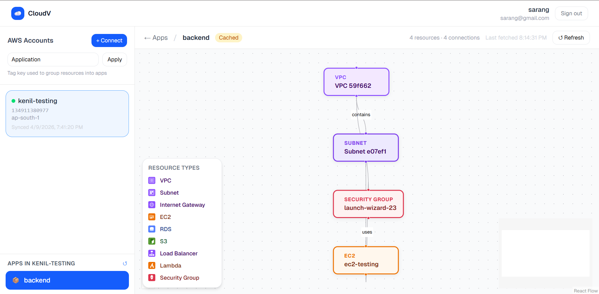

# ☁️ CloudV



> Visualize your AWS infrastructure by application tag — full-stack web app with JWT auth, React Flow graph canvas, and zero permanent credential storage.

---

## 🏗️ Architecture Overview

```
User → React Frontend → Express API → MongoDB
                      ↘ AWS STS AssumeRole → EC2 / RDS / S3 / VPC (read-only)
```

**Key security design:** We never store AWS access keys. Instead, the user creates an IAM Role in their AWS account that trusts your app's AWS account. Your backend calls `sts:AssumeRole` to get **temporary 1-hour credentials**, fetches data, then discards them. Only the Role ARN (encrypted with AES-256) is stored in MongoDB.

---

## 🚀 Quick Start

### Prerequisites
- Node.js 18+
- MongoDB (local or Atlas)
- An AWS account (for running the backend — even a free-tier account works)

### 1. Clone and install

```bash
git clone <your-repo>
cd cloud-mapper

# Backend
cd backend && npm install

# Frontend
cd ../frontend && npm install
```

### 2. Configure backend

```bash
cd backend
cp .env.example .env
```

Edit `.env`:
```env
MONGODB_URI=mongodb://localhost:27017/cloud-mapper
JWT_SECRET=<generate: openssl rand -base64 64>
ENCRYPTION_KEY=<generate: openssl rand -base64 24 | head -c 32>
APP_AWS_REGION=us-east-1
FRONTEND_URL=http://localhost:5173
```

### 3. Run

```bash
# Terminal 1 - Backend
cd backend && npm run dev

# Terminal 2 - Frontend
cd frontend && npm run dev
```

Open http://localhost:5173

---

## 🔐 AWS Setup (for users connecting their account)

### Step 1: Create IAM Role in YOUR AWS account

In AWS Console → IAM → Roles → **Create Role**:

1. **Trusted entity type:** Another AWS account
2. **Account ID:** Your app's AWS Account ID (the account running the backend)
3. **Require external ID:** (optional but recommended) — set to `cloudmapper-secure-external-id`
4. **Permissions:** Attach the custom policy from `iam-policy.json` (or use AWS-managed `ReadOnlyAccess`)
5. **Role name:** `CloudMapperRole`
6. Copy the **Role ARN** — you'll paste this into the app

### Step 2: Tag your AWS resources

Tag ALL resources belonging to an app with the same tag:

| Key | Value |
|-----|-------|
| Application | app-1 |

Resources supported: EC2, VPC, Subnet, Security Group, Internet Gateway, RDS, S3, ELB, Lambda

### Step 3: Connect in the app

1. Login → Click **Connect AWS Account**
2. Paste your Role ARN and AWS Account ID
3. CloudMapper verifies the role by calling AssumeRole
4. Select your app from the sidebar → graph renders automatically

---

## 📁 Project Structure

```
cloudV/
├── server/
│   └── src/
│       ├── db/          # MongoDB connection
│       ├── controllers/     # auth.controller, aws.controller
│       ├── middlewares/      # JWT auth, error handler
│       ├── models/          # User, AWSAccount, AppSnapshot
│       ├── routes/          # auth, aws, app routes
│       ├── services/        # aws.service (SDK), graph.service (builder)
│       └── utils/           # AES-256 encryption util
├── client/
│   └── src/
├       ├── auth/ Login, Signup Pages
│       ├── components/
│       │   ├── graph/       # InfraGraph (React Flow), ResourceNode, GraphLegend
│       │   ├── layout/      # Navbar
│       │   └── ui/          # ConnectAWSModal
│       ├── pages/           # DashboardPage
│       ├── store/           # authStore (Zustand), awsStore (Zustand)
│       ├── services/        # api.ts (Axios + JWT interceptor)
│       ├── lib/             # resourceConfig (icons/colors), utils
│       └── types/           # Shared TypeScript types
```

---

## 🔌 API Reference

### Auth
| Method | Endpoint | Description |
|--------|----------|-------------|
| POST | `/api/auth/register` | Create account |
| POST | `/api/auth/login` | Login, get JWT |
| GET | `/api/auth/me` | Get current user |

### AWS (all require `Authorization: Bearer <token>`)
| Method | Endpoint | Description |
|--------|----------|-------------|
| POST | `/api/aws/connect` | Connect AWS account (validates role) |
| GET | `/api/aws/accounts` | List connected accounts |
| DELETE | `/api/aws/accounts/:id` | Disconnect account |
| GET | `/api/aws/accounts/:id/apps?tagKey=Application` | List tagged apps |
| GET | `/api/aws/accounts/:id/apps/:appTag/graph` | Get resource graph |
| GET | `/api/aws/accounts/:id/apps/:appTag/graph?refresh=true` | Force live fetch |

---

## 🔒 Security Features

| Feature | Implementation |
|---------|----------------|
| JWT auth | HS256, configurable expiry, auth middleware on all AWS routes |
| Password hashing | bcrypt with cost factor 12 |
| No AWS keys stored | Only Role ARN, encrypted with AES-256 |
| Temporary credentials | STS AssumeRole, 1-hour TTL, discarded after use |
| Rate limiting | 100 req/15min globally, 10 req/15min on auth routes |
| Input validation | Zod schemas on all endpoints |
| CORS | Restricted to configured frontend URL |
| Helmet | HTTP security headers |
| User enumeration | Generic error messages on login failure |
| Caching | Snapshots cached 10 min to reduce AWS API calls |

---

## 🖥️ Frontend Features

- **Auth:** Login / Register with form validation and error display
- **Account management:** Connect, list, disconnect AWS accounts
- **Tag key config:** Configurable tag key (default: `Application`)
- **App discovery:** Auto-discovers all tagged app names across resource types
- **React Flow graph:** Pan, zoom, minimap, fit-view
- **Node hover tooltips:** All important resource details on hover
- **Graph legend:** Color-coded by resource type
- **Refresh:** Force-refresh to bypass 10-min cache
- **Cached indicator:** Shows when graph data is from cache

---

## 🧩 Adding More Resource Types

To add a new resource type (e.g. ElastiCache):

1. **`backend/src/services/aws.service.ts`** — add SDK call in `fetchTaggedResources`
2. **`backend/src/services/graph.service.ts`** — add nodes/edges in `buildGraph`
3. **`backend/src/models/AppSnapshot.ts`** — add type to union
4. **`frontend/src/types/index.ts`** — add to `ResourceType`
5. **`frontend/src/lib/resourceConfig.ts`** — add emoji, colors, field formatter

---